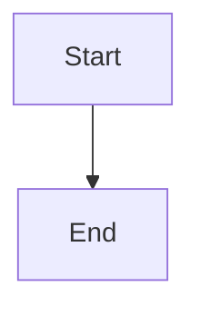
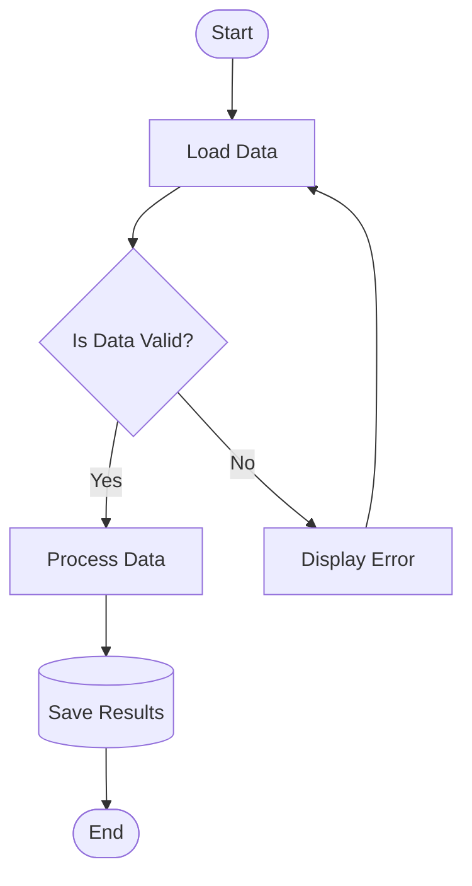
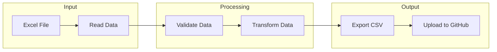
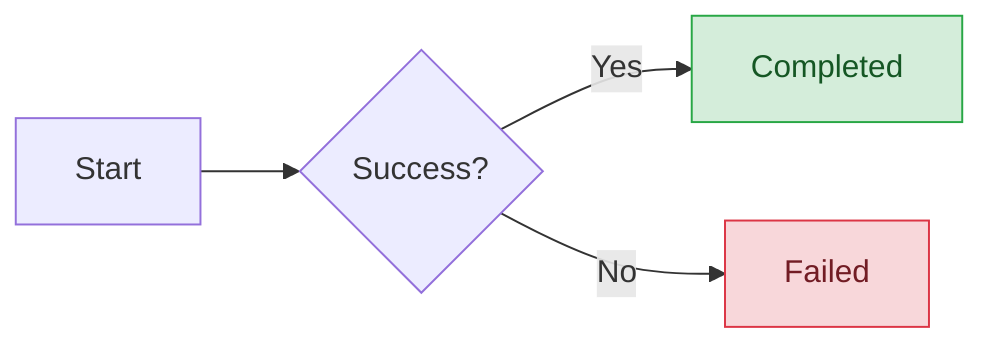
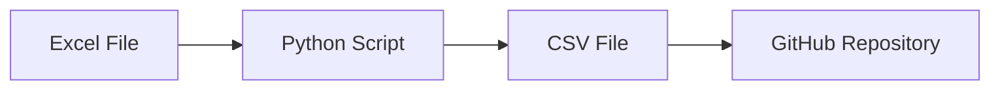

# Mermaid Cheat Sheet – Commands & Syntax

A quick reference for creating Mermaid diagrams in GitHub Markdown.

## 1. Flowchart Directions



- `flowchart TD` – Top to bottom
- `flowchart TB` – Top to bottom
- `flowchart BT` – Bottom to top
- `flowchart LR` – Left to right
- `flowchart RL` – Right to left

## 2. Node Shapes

```text
A[Process]           Rectangle
A(Start)             Rounded rectangle
A([Start])           Stadium shape
A{Decision}          Diamond
A((Event))           Circle
A[[Subroutine]]      Subroutine
A[(Database)]        Cylinder
A>Flag]              Asymmetric shape
A{{Preparation}}     Hexagon
A[/Input/]           Parallelogram
A[\Output\]         Reverse parallelogram
A[/Manual Input\]    Trapezoid
A[\Manual Input/]    Inverted trapezoid
```

## 3. Arrows and Connections

```text
A --> B              Solid arrow
A --- B              Solid line
A -.-> B             Dotted arrow
A -.- B              Dotted line
A ==> B              Thick arrow
A === B              Thick line
A <--> B             Bidirectional arrow
A -->|Yes| B         Labeled arrow
A -- No --> B        Alternative labeled arrow
A --x B              Cross ending
A --o B              Circle ending
```

## 4. Decision Flow Example



## 5. Subgraphs and Grouping



Commands:
- `subgraph Name` – Start a subgraph
- `end` – End a subgraph
- `direction LR` – Left-to-right direction
- `direction TB` – Top-to-bottom direction

## 6. Colors and Styling

```text
style A fill:#90EE90
style A stroke:#000
style A color:#000
style A stroke-width:3px
classDef success fill:#90EE90,stroke:#008000
class A success
linkStyle 0 stroke:red,stroke-width:2px
```

Example:



## 7. Comments and Text

```text
%% This is a comment
A["Long node text"]
A["Line 1<br/>Line 2"]
A["**Important**"]
```

## 8. Other Mermaid Diagram Types

```text
flowchart TD           Flowchart
sequenceDiagram        Sequence diagram
classDiagram           UML class diagram
stateDiagram-v2        State machine
erDiagram              Entity relationship diagram
gantt                  Gantt chart
pie                    Pie chart
journey                User journey
gitGraph               Git branching diagram
mindmap                Mind map
timeline               Timeline
quadrantChart          Quadrant chart
requirementDiagram     Requirements diagram
sankey-beta            Sankey diagram
```

## 9. GitHub Markdown Integration

To render a Mermaid diagram on GitHub, create a Markdown file (.md) and insert a Mermaid code block.

Example:



GitHub automatically renders Mermaid code blocks in Markdown previews.

## 10. Resources

- Official documentation: https://mermaid.js.org/intro/
- Flowchart syntax: https://mermaid.js.org/syntax/flowchart.html
- Mermaid Live Editor: https://mermaid.live/
- GitHub Mermaid guide: https://github.blog/developer-skills/github/include-diagrams-markdown-files-mermaid/
